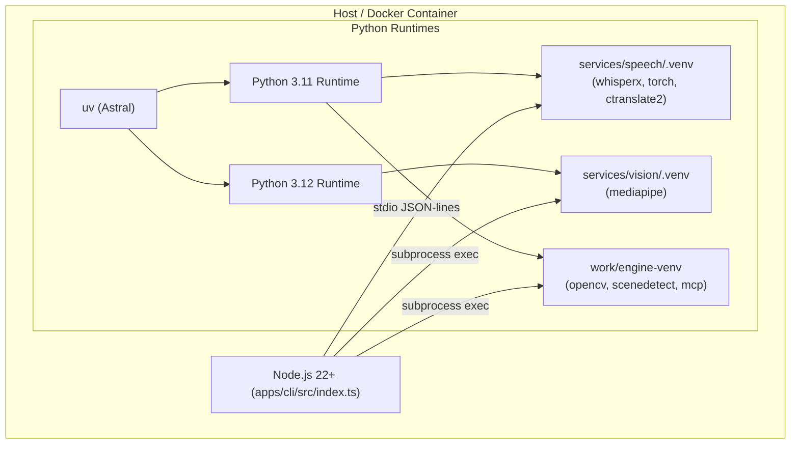
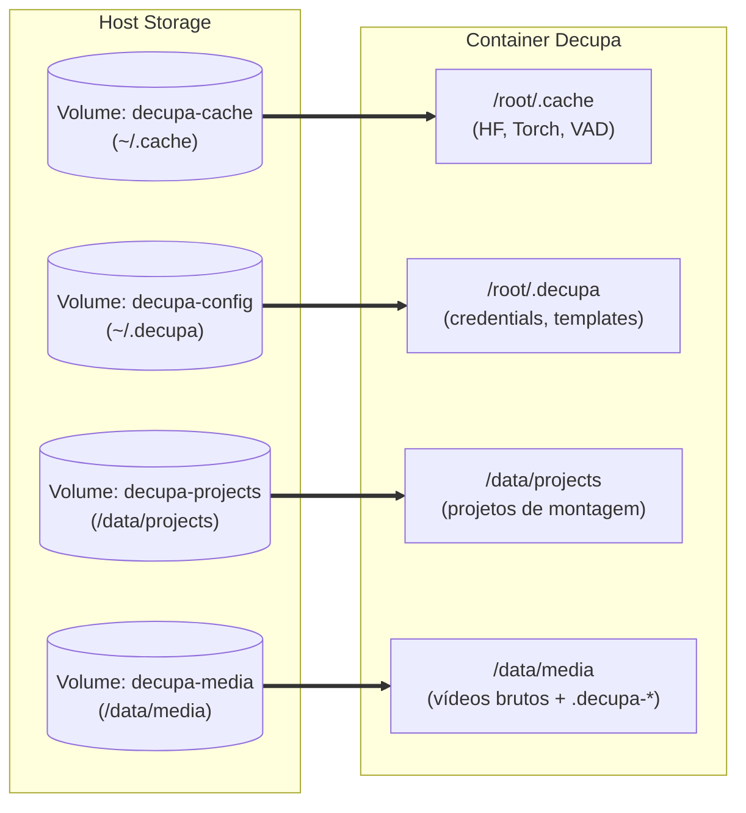

# Pesquisa Técnica: Estratégia de Containerização Multi-Runtime e Persistência de Volumes

> **Ticket Relacionado:** [#112](https://github.com/jhowtkd/decupa/issues/112) — *Estratégia de Containerização Multi-Runtime e Persistência de Volumes*  
> **Mapa Principal:** [#111](https://github.com/jhowtkd/decupa/issues/111) — *Decupa Webapp em Docker para Equipe com Login Único e Upload de Mídia*  
> **Data:** 15 de Outubro de 2026  
> **Status:** Concluído  

---

## 1. Sumário Executivo

O objetivo desta investigação primária é definir a estratégia arquitetural para empacotar a pilha do **Decupa** em contêineres Docker e orquestração Docker Compose, viabilizando o uso como Webapp compartilhado em rede local para a equipe.

O Decupa possui uma arquitetura híbrida com **múltiplos runtimes e ambientes isolados** que operam em conjunto:
1. **Node.js 22+ (TypeScript nativo com `--experimental-strip-types`)**: Executa a aplicação web HTTP, gerenciamento de jobs, rotas de montagem/limpeza, templates e orquestração do pipeline.
2. **Sidecar de Fala (`services/speech`)**: Exige estritamente **Python 3.11** para rodar WhisperX (Whisper `small`, VAD e alinhamento forçado PT-BR via wav2vec2).
3. **Sidecar de Visão (`services/vision`)**: Exige estritamente **Python 3.12** para rodar MediaPipe (`>=0.10.21,<1`) para extração de landmarks faciais e manuais.
4. **Motor de Condense e Render (`work/video-agent-kit-plugin`)**: Exige **Python 3.11** em `work/engine-venv` com dependências travadas (`opencv-python-headless`, `scenedetect`, `mcp`, `numpy`).
5. **FFmpeg e ffprobe**: Responsáveis pela extração de áudio, geração de proxies visuais/acústicos e render final da timeline (com suporte nativo a encoders `libx264` em CPU e `h264_nvenc` em GPU).

Esta pesquisa documenta como consolidar esses requisitos em uma imagem base padronizada baseada em Ubuntu 24.04 LTS (ou Debian 12 Bookworm), mapear e persistir os volumes de cache de modelos (`~/.cache`), configurações/templates (`~/.decupa`), dados de projetos e mídias brutas, garantindo execução em CPU por padrão e suporte transparente para aceleração via GPU NVIDIA através do `nvidia-container-toolkit`.

---

## 2. Diagnóstico dos Runtimes e Fontes Primárias do Repositório

### 2.1. Node.js 22+ e Type-Stripping Nativo

No Decupa, a aplicação TypeScript não passa por um estágio de compilação ou empacotamento com Vite/Webpack/esbuild para o backend. Ela roda diretamente pelo executável do Node.js utilizando o recurso nativo de remoção de tipos.

* **Requisito Mínimo de Versão**:
  * Em [`package.json`](../../package.json#L5):
    ```json
    "engines": { "node": ">=22.12" }
    ```
  * Em [`scripts/setup.mjs`](../../scripts/setup.mjs#L145-L152):
    ```javascript
    export const NODE_MIN = '22.12';
    export function nodeMissing(version = process.versions.node) {
      const [major, minor] = version.split('.').map(Number);
      const [minMajor, minMinor] = NODE_MIN.split('.').map(Number);
      return major > minMajor || (major === minMajor && minor >= minMinor) ? null : `Node >=${NODE_MIN}: https://nodejs.org/`;
    }
    ```
  * Em [`apps/cli/src/doctor.ts`](../../apps/cli/src/doctor.ts#L32):
    ```typescript
    const NODE_MIN = [22, 12] as const;
    ```
* **Execução Direta sem Build**:
  * Em [`package.json`](../../package.json#L12):
    ```json
    "decupa": "node --experimental-strip-types apps/cli/src/index.ts"
    ```
  * Em [`scripts/start.mjs`](../../scripts/start.mjs#L70-L74):
    ```javascript
    const child = spawn(process.execPath, [
      '--experimental-strip-types', join(root, 'apps/cli/src/index.ts'), ...startArgs(argv),
    ], {
      cwd: root, stdio: 'inherit', env: { ...process.env, DECUPA_ENGINE_PYTHON: python },
    });
    ```
* **Gerenciador de Pacotes**:
  * Em [`package.json`](../../package.json#L14): `"packageManager": "pnpm@10.32.1"`.
  * Em [`scripts/setup.mjs`](../../scripts/setup.mjs#L198-L204): O setup baixa o pnpm 10.32.1 localmente em `work/setup-tools/` usando o npm do próprio Node e roda `pnpm install --frozen-lockfile`. Em ambiente Docker, o pnpm 10 pode ser instalado globalmente ou ativado via `corepack enable pnpm`.

> [!IMPORTANT]
> A imagem de contêiner **precisa fornecer Node.js versão >= 22.12** para compatibilidade com a flag `--experimental-strip-types`. Qualquer versão de Node < 22.12 falhará na inicialização da CLI e do servidor.

---

### 2.2. Sidecars Python e UV Multi-Versão

O Decupa possui dois serviços auxiliares ("sidecars") em Python, localizados em `services/`. Uma particularidade essencial descoberta na inspeção do código é que **cada sidecar exige uma versão minor diferente do Python**, tornando inviável usar um único ambiente virtual Python global.



#### Sidecar de Fala (`services/speech`)
* **Versão de Python**:
  * Em [`services/speech/pyproject.toml`](../../services/speech/pyproject.toml#L5):
    ```toml
    requires-python = ">=3.11,<3.12"
    dependencies = ["whisperx"]
    ```
  * Justificativa documentada em [`services/speech/README.md`](../../services/speech/README.md#L3-L4): `torch` e `ctranslate2` dependem de wheels binários que na data de corte não possuíam compatibilidade estável com versões superiores do sistema.
* **Dependências Fixadas**:
  * Em [`services/speech/uv.lock`](../../services/speech/uv.lock): trava `whisperx==3.8.6`, `torch==2.8.0`, `torchaudio==2.8.0`, `transformers`, `ctranslate2`, `pyannote-audio`.
* **Modelos Carregados**:
  * Whisper `small` (~464 MB)
  * VAD PyAnnote (~15 MB)
  * Alinhador forçado PT-BR via wav2vec2 (~2,4 GB)
  * Download e aquecimento via [`services/speech/transcribe.py`](../../services/speech/transcribe.py#L49-L65): `--prepare-models`.
* **Modo de Operação**:
  * Cliente residente: [`packages/transcript/src/client.ts`](../../packages/transcript/src/client.ts#L135) dispara:
    ```typescript
    spawnFn("uv", ["run", "--no-sync", "python", "worker.py", "--serve"], { cwd: speechDir });
    ```
  * O worker residente processa requisições via stdin/stdout JSON-lines, mantendo modelos carregados em RAM e emitindo progresso periódico em stderr com prefixo `DECUPA_PROGRESS`.

#### Sidecar de Visão (`services/vision`)
* **Versão de Python**:
  * Em [`services/vision/pyproject.toml`](../../services/vision/pyproject.toml#L5):
    ```toml
    requires-python = ">=3.12,<3.13"
    dependencies = ["mediapipe>=0.10.21,<1"]
    ```
  * Justificativa documentada em [`services/vision/README.md`](../../services/vision/README.md#L3-L4) e [`services/vision/README.md`](../../services/vision/README.md#L21-L24): MediaPipe exige Python 3.12, e a série 1.0 apresenta falhas no framework gráfico.
* **Modelos Carregados**:
  * Modelos `.task` de `Face Landmarker` e `Hand Landmarker` baixados de URLs do Google Cloud Storage (`services/vision/visual_index.py#L28-L39`) para o diretório `services/vision/.models/`.
* **Modo de Operação**:
  * Disparado por processo avulso por vídeo no pipeline em [`apps/cli/src/app/pipeline.ts`](../../apps/cli/src/app/pipeline.ts#L569-L575):
    ```typescript
    command: "uv",
    args: ["run", "--no-sync", "python", "visual_index.py", "--video", proxy, "--index", indexPath(job), "--fps", "4"]
    ```

#### Papel do `uv` na Containerização
O `uv` (da Astral) é um gerenciador de pacotes e runtimes em Rust extremamente rápido. No contêiner, o `uv` é o pilar que resolve a coexistência de Python 3.11 e 3.12:
* Executar `uv python install 3.11 3.12` provê os runtimes isolados sem depender de PPAs externos instáveis como `deadsnakes`.
* Executar `uv sync --locked --python 3.11` dentro de `services/speech` e `uv sync --locked --python 3.12` dentro de `services/vision` cria os `.venv` com garantia de integridade idêntica à do host.
* O comando `assertSidecarSynced` em [`apps/cli/src/app/pipeline.ts`](../../apps/cli/src/app/pipeline.ts#L380-L385) e no launcher valida `uv sync --locked --check --offline` para assegurar que os ambientes não estão corrompidos ou vazios antes de processar qualquer mídia.

---

### 2.3. Motor de Condense e Render (Engine)

O motor do Decupa foi portado e pinado a partir de um repositório git embutido:
* **Bundle Local**: [`scripts/engine/video-agent-kit.bundle`](../../scripts/engine/README.md) contém o commit de base `d9fe30076c00ce2968d570622dd22ba068337568`.
* **Patch Local**: [`scripts/engine/local-engine.patch`](../../scripts/engine/local-engine.patch) aplica melhorias críticas para PT-BR, limites de memória/threads no render, suporte a `h264_nvenc` e limites de intervalos de frames.
* **Ambiente Virtual**:
  * Criado em `work/engine-venv` com **Python 3.11** ([`scripts/setup.mjs`](../../scripts/setup.mjs#L218-L233)).
  * Dependências instaladas via constraints com versões travadas em [`scripts/engine/requirements.lock.txt`](../../scripts/engine/requirements.lock.txt#L10-L49):
    ```bash
    uv pip install --python work/engine-venv/bin/python -r work/video-agent-kit-plugin/requirements.txt -c scripts/engine/requirements.lock.txt
    uv pip install --python work/engine-venv/bin/python --no-deps scenedetect>=0.6 -c scripts/engine/requirements.lock.txt
    ```
* **Resolução do Executável do Motor**:
  * Controlado pela variável de ambiente `DECUPA_ENGINE_PYTHON`.
  * Em [`apps/cli/src/runtime.ts`](../../apps/cli/src/runtime.ts#L17-L23):
    ```typescript
    export function enginePython(env = process.env, platform = process.platform, root = REPO_ROOT): string {
      if (env.DECUPA_ENGINE_PYTHON) return env.DECUPA_ENGINE_PYTHON;
      const venv = join(root, "work", "engine-venv", platform === "win32" ? "Scripts/python.exe" : "bin/python");
      if (existsSync(venv)) return venv;
      return platform === "win32" ? "python" : "python3";
    }
    ```
  * Em [`apps/cli/src/app/pipeline.ts`](../../apps/cli/src/app/pipeline.ts#L154-L160): Qualquer comando com `command === "python3"` despachado no executor de pipeline redireciona transparentemente para `enginePython()`.

---

### 2.4. Requisitos e Capacidades do FFmpeg

O Decupa utiliza FFmpeg diretamente em múltiplos pontos de alta intensidade:
1. **Geração de Proxies Visuais**: [`apps/cli/src/app/pipeline.ts`](../../apps/cli/src/app/pipeline.ts#L123-L130) gera proxies de vídeo a 4 fps com `libx264` (`-crf 32 -preset veryfast`).
2. **Geração de Proxies de Áudio**: [`apps/cli/src/app/pipeline.ts`](../../apps/cli/src/app/pipeline.ts#L313) extrai faixas de áudio em formato AAC/M4A (`playback.m4a`).
3. **Detecção de Silêncio Acústico**: `@decupa/acoustics` invoca `ffmpeg` com o filtro `silencedetect`.
4. **Render de Linha do Tempo e Concatenador**:
   * O motor possui suporte integrado aos seguintes encoders de vídeo ([`scripts/engine/local-engine.patch`](../../scripts/engine/local-engine.patch#L247-L261)):
     ```python
     VIDEO_ENCODERS = ("libx264", "h264_videotoolbox", "h264_nvenc")
     HARDWARE_ENCODERS = ("h264_videotoolbox", "h264_nvenc")
     ```
   * Verificação de encoders durante setup ([`scripts/setup.mjs`](../../scripts/setup.mjs#L188-L191)):
     ```javascript
     const encoders = execFileSync('ffmpeg', ['-hide_banner', '-encoders'], { encoding: 'utf8', stdio: ['ignore', 'pipe', 'pipe'] });
     if (!/\blibx264\b/.test(encoders) || !/\baac\b/.test(encoders)) missing.push('FFmpeg com libx264 e AAC');
     ```

> [!NOTE]
> No contêiner Docker Linux, o encoder padrão para render e proxies é `libx264` (CPU). No entanto, o motor já contém suporte nativo para `h264_nvenc`, permitindo render acelerado por hardware caso a GPU NVIDIA seja conectada via contêiner!

---

## 3. Mapeamento de Armazenamento, Estados e Volumes Persistentes

Para um contêiner stateless onde dados e caches sobrevivem a recriações de imagem (`docker compose down && docker compose up -d`), é mandatório mapear as seguintes localizações de arquivos para volumes dedicados:

| Categoria | Caminho no Contêiner | Conteúdo | Tamanho Típico | Volume Recomendado |
|---|---|---|---|---|
| **Cache de Modelos** | `/root/.cache/huggingface`<br>`/root/.cache/torch` | Modelos Whisper (small), VAD, wav2vec2 PT-BR | ~3.5 GB a 5 GB | `decupa-cache` |
| **Modelos Visuais** | `/app/services/vision/.models` | Tarefas MediaPipe (`face_landmarker.task`, `hand_landmarker.task`) | ~12 MB | Embutido na imagem ou symlink para volume |
| **Configuração de Usuário** | `/root/.decupa/credentials` | Chaves de API (ZAI, OpenAI, TypeSafe/Jev). Permissão `0600` | Poucos KB | `decupa-config` |
| **Templates Editoriais** | `/root/.decupa/templates/` | Biblioteca de receitas e diretrizes de corte (`<uuid>/recipe.json`) | ~10 a 100 MB | `decupa-config` |
| **Projetos de Montagem** | `/data/projects/` | Arquivos `project.json`, `analysis/`, `decision.json`, derivados | ~1 GB a 10 GB por projeto | `decupa-projects` |
| **Mídias Brutas** | `/data/media/` | Vídeos brutos originais (`.mp4`, `.mov`, `.wav`) | Dezenas a centenas de GB | `decupa-media` |
| **Sessões de Limpeza** | `/data/media/.decupa-<nome>/` | Derivados temporários/trabalho da limpeza (`keep.txt`, proxies, etc.) | ~500 MB a 2 GB por vídeo | Integrado ao volume de mídias |

### 3.1. Detalhes de Cada Estrutura de Armazenamento

#### 1. Cache de Modelos de Fala e Visão
* **Hugging Face Hub**: O WhisperX utiliza o Hugging Face Hub para baixar o modelo de alinhamento forçado para PT-BR (`jonatasgrosman/wav2vec2-large-xlsr-53-portuguese` ou equivalente) e o modelo Whisper small. Por padrão, a biblioteca salva em `~/.cache/huggingface/hub`. A variável de ambiente `HF_HOME=/root/.cache/huggingface` garante que todos os downloads vão para o volume persistente.
* **PyTorch Hub**: Utilizado para modelos auxiliares e checkpoints do detector VAD (Voice Activity Detector), gravados em `~/.cache/torch`. Variável `TORCH_HOME=/root/.cache/torch`.
* **MediaPipe**: Os modelos `.task` ficam localizados em `services/vision/.models/`. No contêiner, eles podem ser pré-instalados na imagem durante o `docker build` (evitando qualquer download em runtime) ou mantidos em link simbólico apontando para `/root/.cache/mediapipe`.

#### 2. Configurações e Credenciais (`~/.decupa/credentials`)
* Implementado em [`packages/triage/src/credentials.ts`](../../packages/triage/src/credentials.ts#L41-L46) e [`packages/triage/src/company-credentials.ts`](../../packages/triage/src/company-credentials.ts).
* Salva credenciais criptográficas/chaves de API (`preset`, `apiKey`, `openaiApiKey`, `typesafeApiKey`, `typesafe: true`).
* **Requisito de Permissões Estritas**: No Linux, o Decupa impõe que o arquivo possua permissões `0600` (leitura e escrita exclusivas do usuário que executa o processo). Ao montar `/root/.decupa`, as permissões do sistema de arquivos POSIX devem ser preservadas.

#### 3. Templates Editoriais (`~/.decupa/templates/`)
* Implementado em [`apps/cli/src/app/templates/store.ts`](../../apps/cli/src/app/templates/store.ts) e [`apps/cli/src/app/server.ts`](../../apps/cli/src/app/server.ts#L818).
* Cada template aprovado ou em rascunho gera uma pasta com UUID em `~/.decupa/templates/<uuid>/recipe.json`.
* Controlado por coordenação de escrita atômica via `@decupa/cache` (`publishAtomic`) e `@decupa/coordinator`.

#### 4. Projetos e Mídias
* **Projetos de Montagem**: O CLI aceita `--project <pasta>`. A pasta do projeto contém o `project.json` e uma pasta interna `analysis/<sha256>/work/out/` contendo `speech_index.json`, `transcript.json` e proxies locais.
* **Mídias e Limpeza**: O CLI aceita `--input <caminho_do_video>`. Em [`apps/cli/src/app/session.ts`](../../apps/cli/src/app/session.ts#L44-L46):
  ```typescript
  export function cleanupWorkDir(input: string): string {
    return join(dirname(input), `.decupa-${basename(input)}`);
  }
  ```
  Isso significa que a pasta de trabalho da limpeza é criada **no mesmo diretório em que o vídeo se encontra**. Portanto, o volume que armazena os vídeos (`decupa-media`) precisa obrigatoriamente ter permissão de escrita para que os derivados da limpeza possam ser gravados ao lado da mídia original.

---

## 4. Arquitetura da Imagem Base e Dockerfile

### 4.1. Seleção da Distribuição Base: Ubuntu 24.04 LTS vs. Debian 12 Bookworm

| Critério | Debian 12 (Bookworm) | Ubuntu 24.04 LTS (Noble) | Escolha Decupa |
|---|---|---|---|
| **glibc** | 2.36 | 2.39 | **Ubuntu 24.04** |
| **FFmpeg do Sistema** | FFmpeg 5.1 | FFmpeg 6.1.1 (com libx264/aac nativos) | **Ubuntu 24.04** |
| **Suporte NVIDIA Container Toolkit** | Suportado | Suporte de primeira classe e drivers atualizados | **Ubuntu 24.04** |
| **Wheels Python (PyTorch/OpenCV)** | Compatível | Compatível | Empate |
| **Disponibilidade Node 22** | Via NodeSource | Via NodeSource | Empate |

**Decisão:** **Ubuntu 24.04 LTS (`ubuntu:24.04`)** é a base recomendada. Ela traz FFmpeg 6.1+ empacotado nativamente com `libx264` e `aac`, bibliotecas C atualizadas, e paridade direta com ambientes de produção e suporte a drivers NVIDIA NVENC/CUDA.

### 4.2. Estratégia de Build em Múltiplos Estágios (Multi-Stage Build)

Para evitar inflar o contêiner final com artefatos temporários de compilação, pacotes desnecessários ou ferramentas de desenvolvimento, a imagem pode ser estruturada em estágios:
1. **Base Comum**: Instala pacotes do sistema (FFmpeg, git, curl, ca-certificates), Node.js 22 LTS, e o binário estático do `uv`.
2. **Builder**: Executa a instalação de Python 3.11 e 3.12 via `uv`, realiza o clone do engine a partir de `video-agent-kit.bundle`, aplica o patch `local-engine.patch`, instala dependências do motor com `requirements.lock.txt`, sincroniza os sidecars com `uv sync --locked`, e instala as dependências JS com `pnpm install --frozen-lockfile`.
3. **Prewarm de Modelos (Opcional ou no Entrypoint)**: Opcionalmente, roda `--prepare-models` para pré-aquecer os modelos padrão de fala e visão dentro da imagem, garantindo que o contêiner funcione 100% offline logo após o boot.

### 4.3. Exemplo de Dockerfile de Produção Multi-Runtime

```dockerfile
# syntax=docker/dockerfile:1.7
FROM ubuntu:24.04 AS base

ENV DEBIAN_FRONTEND=noninteractive \
    TZ=UTC \
    PYTHONUNBUFFERED=1 \
    NODE_ENV=production \
    HF_HOME=/root/.cache/huggingface \
    TORCH_HOME=/root/.cache/torch \
    DECUPA_ENGINE_PYTHON=/app/work/engine-venv/bin/python

# 1. Dependências do sistema: FFmpeg com libx264/aac, git, curl, ca-certificates
RUN apt-get update && apt-get install -y --no-install-recommends \
    ca-certificates \
    curl \
    git \
    ffmpeg \
    libx264-dev \
    build-essential \
    && rm -rf /var/lib/apt/lists/*

# 2. Instalar Node.js 22 LTS oficial e pnpm 10
RUN curl -fsSL https://deb.nodesource.com/setup_22.x | bash - \
    && apt-get install -y --no-install-recommends nodejs \
    && npm install -g pnpm@10.32.1 \
    && rm -rf /var/lib/apt/lists/*

# 3. Instalar Astral uv (binário estático)
COPY --from=ghcr.io/astral-sh/uv:latest /uv /usr/local/bin/uv

# 4. Instalar Python 3.11 e 3.12 via uv
RUN uv python install 3.11 3.12

WORKDIR /app

# 5. Copiar manifestos de dependências para maximizar reaproveitamento de cache
COPY package.json pnpm-lock.yaml pnpm-workspace.yaml tsconfig.json tsconfig.base.json ./
COPY packages/ packages/
COPY apps/ apps/
COPY services/speech/pyproject.toml services/speech/uv.lock services/speech/
COPY services/vision/pyproject.toml services/vision/uv.lock services/vision/
COPY scripts/engine/ scripts/engine/
COPY scripts/ scripts/

# 6. Instalar dependências JavaScript com pnpm
RUN pnpm install --frozen-lockfile

# 7. Sincronizar sidecars Python (Speech = 3.11, Vision = 3.12)
WORKDIR /app/services/speech
RUN uv sync --locked --python 3.11

WORKDIR /app/services/vision
RUN uv sync --locked --python 3.12

# 8. Instalar motor (clone do bundle + patch local + venv Python 3.11)
WORKDIR /app
RUN node scripts/setup.mjs --engine-only \
    && uv venv --python 3.11 /app/work/engine-venv \
    && uv pip install --python /app/work/engine-venv/bin/python \
       -r /app/work/video-agent-kit-plugin/requirements.txt \
       -c /app/scripts/engine/requirements.lock.txt \
    && uv pip install --python /app/work/engine-venv/bin/python \
       --no-deps scenedetect>=0.6 \
       -c /app/scripts/engine/requirements.lock.txt

# 9. Copiar restante do código da aplicação
COPY . .

# 10. Criar diretórios de montagem e script de inicialização
RUN mkdir -p /root/.cache /root/.decupa/templates /data/projects /data/media

EXPOSE 7788

# Entrypoint inteligente que prepara modelos se ainda não existirem no volume persistente
ENTRYPOINT ["/app/scripts/docker-entrypoint.sh"]
CMD ["node", "--experimental-strip-types", "apps/cli/src/index.ts", "montar", "--project", "/data/projects/default", "--port", "7788"]
```

---

## 5. Orquestração e Configuração com Docker Compose

### 5.1. Estrutura de Volumes Persistentes



### 5.2. Arquivo `docker-compose.yml` Completo

Abaixo está a especificação de compose recomendada, contemplando variáveis de ambiente, volumes persistentes e configuração para CPU padrão:

```yaml
services:
  decupa:
    build:
      context: .
      dockerfile: Dockerfile
    image: decupa:latest
    container_name: decupa-app
    restart: unless-stopped
    ports:
      - "7788:7788"
    environment:
      - NODE_ENV=production
      - PORT=7788
      - DECUPA_HOST=0.0.0.0
      - DECUPA_ENGINE_PYTHON=/app/work/engine-venv/bin/python
      - HF_HOME=/root/.cache/huggingface
      - TORCH_HOME=/root/.cache/torch
      # Credenciais corporativas passadas de forma segura via env
      - DECUPA_COMPANY_PRESET=${DECUPA_COMPANY_PRESET:-zai}
      - DECUPA_COMPANY_API_KEY=${DECUPA_COMPANY_API_KEY:-}
      - TYPESAFE_API_KEY=${TYPESAFE_API_KEY:-}
      - DECUPA_TYPESAFE=${DECUPA_TYPESAFE:-1}
    volumes:
      # Cache de modelos pesados de IA (evita redownload de Whisper/wav2vec2)
      - decupa-cache:/root/.cache
      # Configurações do usuário, templates aprovados e credenciais salvas
      - decupa-config:/root/.decupa
      # Diretório para armazenamento dos projetos da equipe
      - decupa-projects:/data/projects
      # Diretório para upload e armazenamento de vídeos grandes
      - decupa-media:/data/media
    # Limites saudáveis de recursos para evitar OOM no host
    deploy:
      resources:
        limits:
          cpus: '8.0'
          memory: 16G
        reservations:
          cpus: '2.0'
          memory: 4G

volumes:
  decupa-cache:
    name: decupa-models-cache
  decupa-config:
    name: decupa-user-config
  decupa-projects:
    name: decupa-projects-data
  decupa-media:
    name: decupa-media-pool
```

---

## 6. Estratégia de Execução: CPU por Padrão e Aceleração NVIDIA Opcional

### 6.1. Execução Padrão em CPU (Portabilidade Total)

Por concepção fundamental do Decupa, a execução local em CPU é totalmente funcional e não depende de nenhuma GPU física:
* **WhisperX**:
  * Em [`services/speech/transcribe.py`](../../services/speech/transcribe.py#L52-L53):
    ```python
    parser.add_argument("--device", default="cpu")
    parser.add_argument("--compute-type", default="int8")
    ```
  * O `compute_type=int8` roda com quantização de 8 bits pelo runtime CTranslate2 em CPU com instruções SIMD/AVX2, apresentando baixo consumo de memória (~1.5 GB RAM) e performance aceitável para vídeos curtos a médios.
  * O worker residente em [`services/speech/worker.py`](../../services/speech/worker.py#L70-L73) normaliza qualquer pedido não especificado (`None`, `""`, `"auto"`, `"gpu"`) para `"cpu"`.
* **FFmpeg**: Utiliza o encoder de software `libx264` configurado com `--preset veryfast -crf 20 -threads 2` no motor de timeline ([`scripts/engine/local-engine.patch`](../../scripts/engine/local-engine.patch#L259-L261)), garantindo previsibilidade de limites de CPU sem travar o contêiner.
* **MediaPipe (Visão)**: Opera nativamente em CPU via thread pool interna.

### 6.2. Aceleração NVIDIA com NVIDIA Container Toolkit

Para equipes com servidores equipados com GPUs NVIDIA (e.g., RTX 3060/4090, Tesla T4/A10), a aceleração por hardware proporciona ganhos substanciais de velocidade:
* Transcrição Whisper e alinhamento forçado até 10x mais rápidos (`device="cuda"`, `compute_type="float16"`).
* Render e transcodificação de timeline via `h264_nvenc` consumindo virtualmente 0% de CPU.

#### Como Habilitar no Compose (`docker-compose.override.yml`)

O usuário ou administrador que possui GPU NVIDIA precisa apenas do driver NVIDIA instalado no host e do pacote `nvidia-container-toolkit`. A configuração no Compose é feita adicionando a reserva de dispositivo:

```yaml
# docker-compose.override.yml
services:
  decupa:
    deploy:
      resources:
        reservations:
          devices:
            - driver: nvidia
              count: all
              capabilities: [gpu, video, compute, utility]
    environment:
      - NVIDIA_VISIBLE_DEVICES=all
      - NVIDIA_DRIVER_CAPABILITIES=compute,video,utility
      # Configuração para que o worker de fala opte por CUDA quando presente
      - DECUPA_SPEECH_DEVICE=cuda
```

#### Suporte no Código do Decupa para Fallback Gracioso
Em [`services/speech/worker.py`](../../services/speech/worker.py#L176-L189):
```python
tried = wanted  # "cuda"
try:
    asr = whisperx.load_model(model, tried, compute_type=compute_type, language=language)
except Exception:
    if tried == "cpu":
        raise
    tried = "cpu"  # Fallback automático para CPU se o driver CUDA falhar!
    key = (model, language, compute_type, tried)
    ...
```
Caso um contêiner configurado com `cuda` seja iniciado em uma máquina onde o toolkit não esteja ativo ou ocorra um erro de inicialização de driver CUDA, o worker faz o **fallback automático para CPU**, assegurando resiliência sem interrupção do serviço.

---

## 7. Recomendações e Conclusões da Pesquisa

1. **Imagem Única Multi-Runtime com `uv`**:
   * Não é necessário nem aconselhável dividir a aplicação em múltiplos microsserviços/contêineres Docker (um contêiner Node, um contêiner Speech, um contêiner Vision).
   * A comunicação atual do Decupa com os sidecars ocorre via **substantivo controle de subprocessos, pipes de stdin/stdout e buffers de linha (JSON-RPC / JSON-lines)** com captura precisa de PIDs e envio de sinais `SIGTERM`/`SIGKILL` ([`apps/cli/src/runtime.ts`](../../apps/cli/src/runtime.ts#L53-L131)).
   * Manter todos os runtimes (Node 22, Speech 3.11, Vision 3.12, Engine 3.11, FFmpeg) dentro do mesmo contêiner preserva integralmente o contrato de execução do Decupa sem exigir refatorações arquiteturais para sockets de rede ou gRPC.

2. **Políticas de Volumes**:
   * Volume `decupa-cache` (montado em `/root/.cache`) é mandatório para evitar o download de ~3 GB a cada reinicialização.
   * Volume `decupa-config` (montado em `/root/.decupa`) garante persistência de credenciais criptografadas e templates da equipe.
   * Volumes `decupa-projects` e `decupa-media` devem permitir mapeamento flexível para diretórios locais do host ou armazenamento em rede (NAS).

3. **Prontidão do Diagnóstico**:
   * O comando `node --experimental-strip-types apps/cli/src/index.ts doctor --local` deve ser executado no estágio final da construção da imagem para validar a higienização de todos os runtimes e imports de pacotes Python antes de homologar o contêiner.

4. **Pontes para os Próximos Tickets do Mapa #111**:
   * **Ticket #113 (Bypass Seguro de Host/Origin)**: No contêiner, o Decupa precisará aceitar conexões não-loopback (`0.0.0.0`) e cabeçalhos `Host`/`Origin` do gateway ou da LAN sem disparar bloqueios de segurança locais.
   * **Ticket #114 (Gateway de Autenticação)**: Um proxy reverso (Nginx/Traefik) na borda cuidará da autenticação única, encaminhando requisições para a porta 7788 do contêiner Decupa.
   * **Ticket #115 (API de Ingestão e Upload Web)**: Utilizará o volume compartilhado `/data/media` para descarregar arquivos brutos enviados pela interface web.
