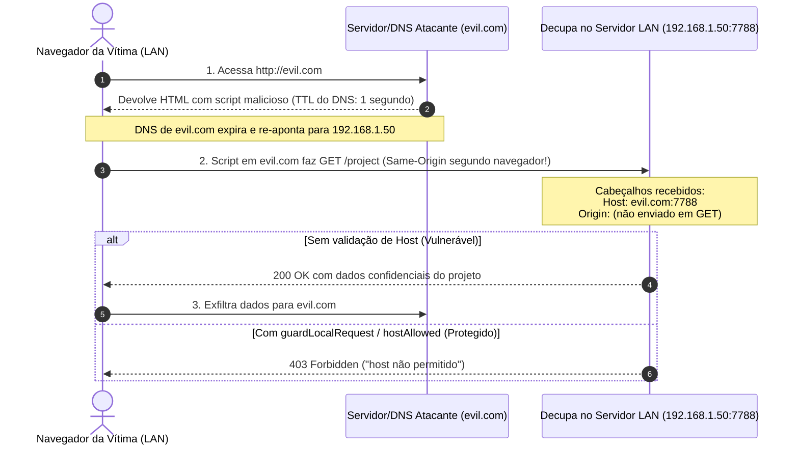
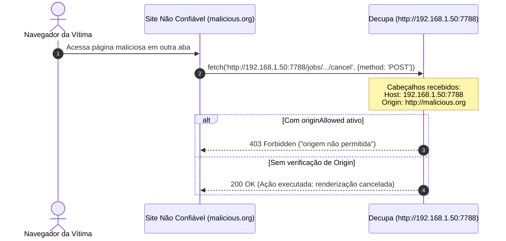

# Pesquisa Arquitetural: Adaptação de Rede e Bypass Seguro de Host/Origin para Webapp

- **Ticket de Referência:** [#113: Adaptação de Rede e Bypass Seguro de Host/Origin para Webapp](https://github.com/jhowtkd/decupa/issues/113)
- **Ticket Pai:** [#111: Mapa: Decupa Webapp em Docker para Equipe com Login Único e Upload de Mídia](https://github.com/jhowtkd/decupa/issues/111)
- **Tickets Dependentes/Bloqueados:** [#114: Arquitetura do Gateway de Autenticação Única na Borda](https://github.com/jhowtkd/decupa/issues/114), [#112: Estratégia de Containerização Multi-Runtime](https://github.com/jhowtkd/decupa/issues/112)
- **Data:** Outubro de 2026
- **Status:** Concluído / Pronto para Especificação e Implementação

---

## 1. Sumário Executivo

O Decupa foi projetado originalmente como uma ferramenta de desktop local focada no operador único. Seu modelo de segurança HTTP assume que o serviço é sempre consumido pelo navegador local na mesma máquina física, amarrado estritamente à interface de loopback (`127.0.0.1`) com guardas rígidos de cabeçalhos contra ataques originados em outras abas do navegador da vítima.

Ao migrar o Decupa para a topologia de **Webapp conteinerizado em Docker para acesso por equipe em rede local (LAN)** sob um **Gateway de Autenticação Única na Borda** ([#111](https://github.com/jhowtkd/decupa/issues/111), [#114](https://github.com/jhowtkd/decupa/issues/114)), a camada de rede atual colapsa imediatamente devido a quatro barreiras embutidas no código:

1. **Ligação Estrita ao Loopback (`127.0.0.1`):** `server.listen(port, "127.0.0.1")` impede que o tráfego roteado pelas pontes do Docker (`docker-proxy` / `bridge`) ou por interfaces de rede física (LAN) alcance o processo Node.js.
2. **Portão de DNS Rebinding (`hostAllowed` / `guardLocalRequest`):** Rejeita com `403 Forbidden` (`{"error": "host não permitido"}`) qualquer requisição cujo cabeçalho `Host` não seja literalmente `127.0.0.1:${port}` ou `localhost:${port}`, bloqueando domínios locais (ex.: `decupa.studio.internal`), IPs de LAN (ex.: `192.168.1.50:7788`) e nomes de serviço Docker (ex.: `decupa:7788`).
3. **Portão de Proteção CSRF (`originAllowed`):** Rejeita com `403 Forbidden` (`{"error": "origem não permitida"}`) requisições mutadoras (`POST`) se o cabeçalho `Origin` não for exatamente `http://127.0.0.1:${port}` ou `http://localhost:${port}`. Em ambientes com terminação TLS no proxy reverso (`https://`) ou com mapeamento de portas externas divergentes da porta interna (`:80`, `:443`, `:8080`), as mutações falham sistematicamente.
4. **Acoplamentos de URL de Loopback no Core:** Rotas como `POST /project/new` geram e retornam URLs fixas `http://127.0.0.1:${next.port}/` em portas efêmeras não publicadas, quebrando a navegação em clientes remotos.

Este relatório investiga detalhadamente as bases de código envolvidas, avalia os vetores de ataque reais (DNS rebinding, CSRF e falsificação de cabeçalhos de proxy), analisa o comportamento dos proxies reversos Caddy e Nginx e propõe uma **arquitetura híbrida declarativa e segura** baseada em variáveis de ambiente (`DECUPA_BIND_HOST`, `DECUPA_ALLOWED_HOSTS`, `DECUPA_ALLOWED_ORIGINS`, `DECUPA_TRUST_PROXY`), garantindo compatibilidade com Docker e proxies sem abrir mão da segurança em redes compartilhadas.

---

## 2. Diagnóstico da Camada HTTP Atual no Decupa

A auditoria do código-fonte revelou os pontos exatos de bloqueio na arquitetura atual:

### 2.1. O Módulo de Segurança de Origem e Host (`apps/cli/src/http/origin.ts`)

O arquivo [apps/cli/src/http/origin.ts](file:///home/jhonatan/decupa-research-network/apps/cli/src/http/origin.ts) encapsula a política de segurança de transporte HTTP local do Decupa:

```typescript
// apps/cli/src/http/origin.ts:13-16
export function originAllowed(origin: string | undefined, port: number): boolean {
  if (origin === undefined) return true;
  return origin === `http://127.0.0.1:${port}` || origin === `http://localhost:${port}`;
}

// apps/cli/src/http/origin.ts:25-29
export function hostAllowed(host: string | undefined, port: number): boolean {
  if (host === undefined) return false;
  const value = host.toLowerCase();
  return value === `127.0.0.1:${port}` || value === `localhost:${port}`;
}

// apps/cli/src/http/origin.ts:38-54
export function guardLocalRequest(
  req: { headers: { host?: string } },
  res: ServerResponse,
  port: number,
): boolean {
  res.setHeader("content-security-policy", "frame-ancestors 'none'");
  res.setHeader("x-frame-options", "DENY");
  if (hostAllowed(req.headers.host, port)) return true;
  const payload = JSON.stringify({ error: "host não permitido" });
  res.writeHead(403, {
    "content-type": "application/json; charset=utf-8",
    "content-length": Buffer.byteLength(payload),
    "cache-control": "no-store",
  });
  res.end(payload);
  return false;
}
```

#### Problemas Identificados:
1. **Suposição de Esquema Único (`http://`):** `originAllowed` só testa o protocolo `http://`. Quando o Decupa está atrás de um proxy com terminação TLS (HTTPS), o navegador do cliente envia `Origin: https://decupa.studio.internal`, resultando em `403` imediato em qualquer `POST`.
2. **Suposição de Identidade de Porta Interna/Externa:** Tanto `hostAllowed` quanto `originAllowed` interpolam a variável `${port}` (a porta do socket TCP local no Node.js). Se o container escuta na porta 7788, mas o proxy expõe na porta padrão 80, 443 ou 8080:
   - Requisições na porta 80 ou 443 omitem a porta por especificação HTTP (RFC 9110 §7.2: *`A "host" without a trailing port implies the default port`*). O navegador envia `Host: decupa.studio.internal` (sem `:443`). O Decupa testa `decupa.studio.internal === decupa.studio.internal:7788`, falhando.
   - Requisições em portas mapeadas pelo Docker (ex.: `-p 8888:7788`) chegam com `Host: host:8888` e `Origin: http://host:8888`. O Decupa testa contra a porta 7788 e rejeita.
3. **Ausência de Suporte a Nomes de Rede e Proxies:** Não há mecanismo para declarar domínios confiáveis, subredes de LAN, nem suporte a cabeçalhos padrão como `X-Forwarded-Host`.

### 2.2. A Inicialização e Amarração de Servidores (`apps/cli/src/app/server.ts`)

O Decupa possui dois servidores principais em [apps/cli/src/app/server.ts](file:///home/jhonatan/decupa-research-network/apps/cli/src/app/server.ts):

1. **`startApp` (Modo "Limpar"):**
   - Linha 419: `if (!guardLocalRequest(req, res, boundPort)) return;`
   - Linha 426: `if (req.method !== "GET" && !originAllowed(req.headers.origin, boundPort))`
   - Linha 726: `server.listen(opts.port ?? 7788, "127.0.0.1", resolve);` (hardcoded para loopback).
   - Linha 738: Retorna objeto com `address: "127.0.0.1"`.

2. **`startAssemblyApp` (Modo "Montar"):**
   - Linha 849: `if (!guardLocalRequest(req, res, boundPort)) return;`
   - Linha 851: `if (req.method !== "GET" && !originAllowed(req.headers.origin, boundPort))`
   - Linhas 857-868: A criação de novo projeto (`POST /project/new`) sobe um novo processo ou instância na porta efêmera `port: 0` e devolve:
     ```typescript
     const nextUrl = `http://127.0.0.1:${next.port}/`;
     sendJson(res, { url: nextUrl, dir: nextDir }, 201);
     ```
     Num navegador remoto, essa resposta instrui o cliente a redirecionar para `127.0.0.1`, que é o computador do próprio usuário (onde não há servidor rodando). Além disso, em Docker, portas efêmeras dinâmicas não estão publicadas no `docker run -p`!
   - Linha 901: `server.listen(opts.port ?? 7788, "127.0.0.1", resolve);` (hardcoded para loopback).

### 2.3. Rotas com Validação Própria de Origem

Além do middleware central no servidor, rotas de subdomínio repetem a verificação de origem:
- **`apps/cli/src/app/assembly/routes.ts` (linha 647):**
  `if (req.method !== "GET" && !originAllowed(req.headers.origin, deps.port()))`
- **`apps/cli/src/app/templates/routes.ts` (linha 43):**
  `if (req.method !== "GET" && !originAllowed(req.headers.origin, deps.port())) throw new HttpError(403, "origem não permitida");`

Qualquer ajuste em `originAllowed` reflete automaticamente nessas rotas, mantendo consistência se a assinatura for preservada ou compatibilizada.

### 2.4. Servidor Auxiliar do Marcador Web (`apps/cli/src/mark-web/server.ts`)

- Linhas 74 e 86: Executa `guardLocalRequest` e `originAllowed`.
- Linha 172: `server.listen(opts.port ?? 7777, "127.0.0.1", ...)`.

### 2.5. Ponto de Entrada da CLI e Scripts de Inicialização

- **`apps/cli/src/index.ts` (linhas 371-430):**
  Os comandos `limpar` e `montar` usam `parseArgs` com opções fixas (`input`, `project`, `port`, `provider`, `allow-paid-*`). Não aceitam parâmetros de interface de rede (`--host` ou `--bind`). Após iniciar, invocam `openBrowser(url)`.
- **`apps/cli/src/runtime.ts` (linhas 29-50):**
  A função `browserCommand(url)` possui a validação:
  `if (!/^http:\/\/127\.0\.0\.1:\d{1,5}\/?$/.test(url)) return null;`
  Em ambiente Docker/headless, a tentativa de abrir navegador local falha ou imprime aviso no console, o que é aceitável, mas o regex impede qualquer URL com IP ou hostname de rede.
- **`scripts/start.mjs` (linhas 22-34):**
  Script utilizado em desenvolvimento local. Aceita apenas `--project`, `--input` e `--port`.

---

## 3. Análise dos Vetores de Ameaça e Impacto de Mudanças

Antes de propor alterações nas verificações de rede, é essencial detalhar o modelo de ameaça (*Threat Model*) que fundamentou a arquitetura atual:

### 3.1. Vetor 1: DNS Rebinding Attack



#### Como Funciona:
1. O atacante hospeda um site em `evil.com` com resolução DNS tendo TTL muito curto (ex.: 1 segundo).
2. O usuário na LAN acessa `evil.com`. O navegador executa o JavaScript do atacante.
3. O servidor DNS do atacante altera o registro `A` de `evil.com` para o IP interno da LAN (ex.: `192.168.1.50` ou `127.0.0.1`).
4. O script no navegador efetua requisições `fetch('http://evil.com:7788/project')`.
5. Pela política de mesma origem (*Same-Origin Policy* - SOP) do navegador, o domínio ainda é `evil.com`. Portanto:
   - O navegador trata a requisição como **Same-Origin**.
   - O navegador **permite a leitura completa do corpo da resposta** (ao contrário de requisições cross-origin comuns).
   - O navegador **não envia o cabeçalho `Origin` em requisições `GET`**.
6. **A única defesa contra DNS Rebinding no servidor HTTP é inspecionar o cabeçalho `Host`**. O navegador transmite `Host: evil.com:7788`.
7. O `hostAllowed` do Decupa detecta que `evil.com:7788` não está na lista de hosts autorizados e aborta imediatamente com HTTP 403 antes de qualquer dado ser lido.

> [!CAUTION]
> **Risco de Bypass Cego:** Se o Decupa simplesmente desativar a verificação de `Host` ou permitir wildcard irrestrito (`*`), qualquer usuário da equipe que acessar qualquer site de terceiros na internet enquanto estiver conectado à rede do estúdio deixará o Decupa exposto ao roubo completo de projetos, transcrições e chaves de API via DNS rebinding.

### 3.2. Vetor 2: Cross-Origin Request Forgery (CSRF)



#### Como Funciona:
1. O usuário está com o Decupa aberto em `http://192.168.1.50:7788` e, em outra aba, navega em um site arbitrário.
2. O site arbitrário dispara um `fetch` com método `POST` contra `http://192.168.1.50:7788/jobs/.../cancel` ou `/settings`.
3. Embora o navegador impeça a página maliciosa de ler a resposta (devido à ausência de cabeçalhos CORS `Access-Control-Allow-Origin`), o navegador **executa o envio do POST** se não houver mecanismos anti-CSRF.
4. No entanto, os navegadores modernos sempre enviam o cabeçalho `Origin` em requisições não-GET (CORS ou same-origin).
5. O `originAllowed` do Decupa verifica se a origem do disparo bate com o endereço do próprio aplicativo. Se for `Origin: http://malicious.org`, o Decupa barra o processamento antes que o comando seja executado.

### 3.3. Vetor 3: Falsificação de Cabeçalhos de Proxy (*Host Header Injection*)

Quando uma aplicação lê cegamente `X-Forwarded-Host` sem validar a procedência da requisição:
- Um atacante direto na rede LAN pode enviar:
  ```http
  GET / HTTP/1.1
  Host: 192.168.1.50:7788
  X-Forwarded-Host: localhost:7788
  ```
- Se a aplicação der preferência ao `X-Forwarded-Host` sobre o `Host` sem checar se a requisição veio de um proxy confiável, ela pode contornar proteções ou envenenar caches e links gerados.
- **Regra de Ouro:** Cabeçalhos `X-Forwarded-*` só podem ser considerados se o Decupa estiver explicitamente configurado para operar em modo proxy confiável (`DECUPA_TRUST_PROXY=1`), e mesmo assim o host final resolvido deve pertencer à lista de hosts permitidos.

---

## 4. Topologias de Implantação e Interação com Proxies Reversos

No ecossistema planejado na issue [#111](https://github.com/jhowtkd/decupa/issues/111), há dois cenários primários de rede:

### Topologia A: Docker com Mapeamento Direto de Portas (LAN Simples)
```
[Navegadores da Equipe na LAN] 
            │
            ▼ (HTTP - ex.: http://192.168.1.50:7788)
┌────────────────────────────────────────────────────────┐
│ Servidor Físico / Host Docker                          │
│                                                        │
│  Porta do Host: 7788                                  │
│         │ (docker-proxy bridge)                        │
│         ▼                                              │
│  ┌──────────────────────────────────────────────────┐  │
│  │ Container Docker do Decupa                       │  │
│  │                                                  │  │
│  │  Interface eth0 (0.0.0.0:7788)                   │  │
│  │  Decupa Node.js HTTP Server                      │  │
│  └──────────────────────────────────────────────────┘  │
└────────────────────────────────────────────────────────┘
```
- **Requisitos de Rede:**
  - O Node.js no container deve escutar em `0.0.0.0:7788`.
  - O `Host` recebido é `192.168.1.50:7788`.
  - O `Origin` enviado nos POSTs é `http://192.168.1.50:7788`.

---

### Topologia B: Gateway de Borda com Proxy Reverso e Autenticação (Recomendado na Issue #114)
```
[Navegadores da Equipe na LAN]
            │
            ▼ (HTTPS / HTTP - ex.: https://decupa.studio.internal ou basic_auth)
┌────────────────────────────────────────────────────────┐
│ Servidor Físico / Docker Compose                       │
│                                                        │
│  ┌──────────────────────────────────────────────────┐  │
│  │ Container: Gateway de Borda (Caddy ou Nginx)    │  │
│  │ - Terminação TLS (certificado local/Let's Encrypt)│  │
│  │ - Autenticação Única da Equipe (Basic/Cookie)    │  │
│  │ - Filtragem de Host na borda                      │  │
│  └───────────────────────┬──────────────────────────┘  │
│                          │ Rede Docker Interna          │
│                          ▼ (http://decupa:7788)        │
│  ┌──────────────────────────────────────────────────┐  │
│  │ Container: Decupa Webapp                         │  │
│  │ - Escuta em 0.0.0.0:7788                         │  │
│  │ - Portas isoladas na rede interna (sem -p direto) │  │
│  │ - Confia no gateway configurado                  │  │
│  └──────────────────────────────────────────────────┘  │
└────────────────────────────────────────────────────────┘
```

#### Comportamento dos Proxies Reversos:

#### 1. Caddy v2:
- Por padrão, a diretiva `reverse_proxy upstream:port` do Caddy **preserva o cabeçalho `Host` original enviado pelo navegador** (não sobrescreve para `upstream:port`).
- Adiciona automaticamente os cabeçalhos:
  - `X-Forwarded-For: <ip-do-cliente>`
  - `X-Forwarded-Proto: https` (ou `http`)
  - `X-Forwarded-Host: <host-original>`
- O cabeçalho `Origin` do navegador passa inalterado.
- Caddy suporta streaming de mídia com `Accept-Ranges` e HTTP 206 Partial Content nativamente, sem exigir ajustes especiais de buffer.

Exemplo de configuração Caddy (`Caddyfile`):
```caddyfile
decupa.studio.internal {
    basic_auth {
        equipe $2a$14$ExemploDeHashBcryptParaLoginUnico114
    }

    # Passa as requisições para o container do Decupa na rede interna
    reverse_proxy decupa:7788 {
        # Preserva cabeçalhos de host e encaminhamento
        header_up Host {host}
        header_up X-Forwarded-Host {host}
        header_up X-Forwarded-Proto {scheme}
    }
}
```

#### 2. Nginx:
- Por padrão, o Nginx substitui o cabeçalho `Host` pelo nome do upstream especificado em `proxy_pass` (ex.: `Host: decupa`).
- Para repassar o host do cliente e viabilizar o streaming de vídeo de alta capacidade sem travar a memória do proxy, o Nginx requer configuração explícita:
```nginx
server {
    listen 80;
    listen 443 ssl;
    server_name decupa.studio.internal;

    # Autenticação de Borda (Issue #114)
    auth_basic "Acesso Restrito - Equipe Decupa";
    auth_basic_user_file /etc/nginx/.htpasswd;

    # Suporte a upload de mídias grandes (Issue #115)
    client_max_body_size 50G;

    location / {
        proxy_pass http://decupa:7788;
        
        # Cabeçalhos essenciais de Host e Encaminhamento
        proxy_set_header Host $http_host;
        proxy_set_header X-Forwarded-Host $http_host;
        proxy_set_header X-Forwarded-Proto $scheme;
        proxy_set_header X-Forwarded-For $proxy_add_x_forwarded_for;

        # Otimizações de streaming de vídeo (apps/cli/src/http/media.ts)
        proxy_force_ranges on;
        proxy_buffering off;
        proxy_http_version 1.1;
        proxy_set_header Connection "";
    }
}
```

---

## 5. Comparativo de Soluções Arquiteturais

Avaliamos quatro abordagens para atender o Ticket [#113](https://github.com/jhowtkd/decupa/issues/113):

| Critério | Abordagem 1: Bypass Cego (`DECUPA_INSECURE_DISABLE_HOST_CHECK=1`) | Abordagem 2: Whitelist Rígida com Variáveis (`DECUPA_ALLOWED_HOSTS`) | Abordagem 3: Confiança Cega em `X-Forwarded-*` | Abordagem 4 (Recomendada): Híbrida Declarativa + Suporte a Proxy Confiável |
| :--- | :---: | :---: | :---: | :---: |
| **Proteção DNS Rebinding** | ❌ **Nula** (Vulnerável) | ✅ **Total** | ⚠️ **Parcial** (Risco de injeção) | ✅ **Total** (Validado contra whitelist) |
| **Proteção CSRF** | ❌ **Nula** | ✅ **Total** | ⚠️ Frágil | ✅ **Total** (Validado contra whitelist) |
| **Flexibilidade Docker (Port Mapping)** | ✅ Fácil | ⚠️ Exige configurar porta externa | ⚠️ Depende de headers | ✅ Suporta IP + porta mapeada |
| **Flexibilidade Proxy Reverso (Caddy/Nginx)** | ✅ Fácil | ⚠️ Requer especificar host exato | ✅ Automático se headers existirem | ✅ Suporta host com/sem porta e TLS |
| **Segurança Padrão (Zero-Config)** | ✅ Mantém `127.0.0.1` | ✅ Mantém `127.0.0.1` | ✅ Mantém `127.0.0.1` | ✅ Mantém `127.0.0.1` |

### Veredito:
A **Abordagem 4** é a única que atende todos os requisitos de segurança e operação corporativa. Ela combina configuração explícita e determinística com suporte seguro a cabeçalhos de proxy.

---

## 6. Especificação da Arquitetura Recomendada

### 6.1. Variáveis de Ambiente e Opções de Inicialização

Propõe-se a introdução de quatro variáveis de ambiente (e opções de CLI correspondentes):

1. **`DECUPA_BIND_HOST` (string, opcional, default: `"127.0.0.1"`):**
   - Define a interface na qual o socket TCP escutará (`server.listen(port, host)`).
   - Para execução local tradicional: mantém `"127.0.0.1"` (zero quebra de comportamento existente).
   - Para Docker ou exposição direta na LAN: configura-se `DECUPA_BIND_HOST="0.0.0.0"`.
   - CLI: flag `--bind <ip>` ou `--host <ip>` em `limpar` e `montar`.

2. **`DECUPA_ALLOWED_HOSTS` (string, opcional, lista separada por vírgula):**
   - Lista de hostnames ou IPs autorizados a acessar o Decupa.
   - Padrão implícito sempre presente: `127.0.0.1:${port}` e `localhost:${port}`.
   - Formatos suportados:
     - `decupa.studio.internal` (permite com qualquer porta ou portas padrão 80/443).
     - `192.168.1.50:7788` (exige a porta específica 7788).
     - `decupa:7788` (para comunicação interna entre containers Docker).
     - `*.studio.internal` (suporte a wildcard de subdomínio, caso necessário para ambientes dinâmicos).

3. **`DECUPA_ALLOWED_ORIGINS` (string, opcional, lista separada por vírgula):**
   - Lista explícita de origens autorizadas para requisições com mutação (`POST`).
   - Se omitida, **é auto-derivada automaticamente a partir de `DECUPA_ALLOWED_HOSTS`**, gerando variantes com `http://` e `https://`.
   - Permite autorizar explicitamente origens em portas divergentes da porta de bind local (ex.: `https://decupa.studio.internal`, `http://192.168.1.50:8080`).

4. **`DECUPA_TRUST_PROXY` (boolean: `"1"` | `"true"`, opcional, default: `"false"`):**
   - Quando ativado, indica que o Decupa está posicionado atrás de um gateway confiável (Caddy, Nginx).
   - Em caso positivo, o Decupa avalia `X-Forwarded-Host` e `X-Forwarded-Proto` para conferência de Host e geração de URLs internas, conferindo o valor resultante contra a lista `DECUPA_ALLOWED_HOSTS`.

---

### 6.2. Algoritmo Refatorado de Validação de Host e Origem

Propõe-se a seguinte evolução para `apps/cli/src/http/origin.ts`:

```typescript
export interface NetworkSecurityConfig {
  bindHost: string;
  allowedHosts: string[];
  allowedOrigins: string[];
  trustProxy: boolean;
}

/**
 * Lê configurações de ambiente mantendo defaults locais seguros.
 */
export function getNetworkSecurityConfig(env = process.env): NetworkSecurityConfig {
  const bindHost = env.DECUPA_BIND_HOST?.trim() || "127.0.0.1";
  const rawHosts = env.DECUPA_ALLOWED_HOSTS
    ? env.DECUPA_ALLOWED_HOSTS.split(",").map((h) => h.trim().toLowerCase()).filter(Boolean)
    : [];
  const rawOrigins = env.DECUPA_ALLOWED_ORIGINS
    ? env.DECUPA_ALLOWED_ORIGINS.split(",").map((o) => o.trim().toLowerCase()).filter(Boolean)
    : [];
  const trustProxy = env.DECUPA_TRUST_PROXY === "1" || env.DECUPA_TRUST_PROXY === "true";

  return {
    bindHost,
    allowedHosts: rawHosts,
    allowedOrigins: rawOrigins,
    trustProxy,
  };
}

/**
 * Normaliza e confere se um cabeçalho Host é aceito.
 */
export function hostAllowed(
  hostHeader: string | undefined,
  boundPort: number,
  config = getNetworkSecurityConfig(),
): boolean {
  if (!hostHeader) return false;
  const incoming = hostHeader.toLowerCase().trim();

  // 1. Sempre aceita loopback local na porta vinculada
  if (incoming === `127.0.0.1:${boundPort}` || incoming === `localhost:${boundPort}`) {
    return true;
  }

  // 2. Separa hostname e porta
  const [hostname, portStr] = incoming.split(":");
  const port = portStr ? Number(portStr) : undefined;

  // 3. Verifica contra DECUPA_ALLOWED_HOSTS
  for (const pattern of config.allowedHosts) {
    if (pattern === incoming) return true;
    // Se o pattern não especificou porta (ex: "decupa.lan"), aceita o host com ou sem porta
    if (!pattern.includes(":") && pattern === hostname) return true;
  }

  return false;
}

/**
 * Valida o cabeçalho Origin contra CSRF.
 */
export function originAllowed(
  origin: string | undefined,
  boundPort: number,
  config = getNetworkSecurityConfig(),
): boolean {
  // Clientes não-navegador (curl, CLI, MCP) não mandam Origin e continuam liberados
  if (origin === undefined) return true;
  if (origin === "null") return false;

  const incoming = origin.toLowerCase().trim();

  // 1. Sempre aceita loopback local
  if (incoming === `http://127.0.0.1:${boundPort}` || incoming === `http://localhost:${boundPort}`) {
    return true;
  }

  // 2. Confere contra origens explícitas
  if (config.allowedOrigins.includes(incoming)) {
    return true;
  }

  // 3. Confere contra origens auto-derivadas de allowedHosts
  try {
    const parsed = new URL(incoming);
    const hostWithPort = parsed.host; // ex: "192.168.1.50:7788" ou "decupa.studio.internal"
    const hostnameOnly = parsed.hostname;

    for (const pattern of config.allowedHosts) {
      if (pattern === hostWithPort || pattern === hostnameOnly) {
        return true;
      }
    }
  } catch {
    return false;
  }

  return false;
}

/**
 * Portão unificado aplicado na primeira linha de cada requisição.
 */
export function guardRequest(
  req: { headers: { host?: string; "x-forwarded-host"?: string | string[] } },
  res: ServerResponse,
  boundPort: number,
  config = getNetworkSecurityConfig(),
): boolean {
  res.setHeader("content-security-policy", "frame-ancestors 'none'");
  res.setHeader("x-frame-options", "DENY");

  // Determina o host efetivo
  let effectiveHost = req.headers.host;
  if (config.trustProxy && req.headers["x-forwarded-host"]) {
    const fwd = req.headers["x-forwarded-host"];
    effectiveHost = Array.isArray(fwd) ? fwd[0] : fwd.split(",")[0].trim();
  }

  if (hostAllowed(effectiveHost, boundPort, config)) return true;

  const payload = JSON.stringify({ error: "host não permitido" });
  res.writeHead(403, {
    "content-type": "application/json; charset=utf-8",
    "content-length": Buffer.byteLength(payload),
    "cache-control": "no-store",
  });
  res.end(payload);
  return false;
}
```

---

### 6.3. Desacoplamento da Geração de URLs Internas e Navegação

Em [apps/cli/src/app/server.ts](file:///home/jhonatan/decupa-research-network/apps/cli/src/app/server.ts) (linhas 857-868), a rota `POST /project/new` retorna uma URL absoluta vinculada ao loopback:
```typescript
const nextUrl = `http://127.0.0.1:${next.port}/`;
sendJson(res, { url: nextUrl, dir: nextDir }, 201);
```

#### Solução Arquitetural:
1. **Curto Prazo:** Se o servidor estiver operando com `DECUPA_TRUST_PROXY` ou `DECUPA_ALLOWED_HOSTS`, derivar a URL usando o esquema (`X-Forwarded-Proto` ou `http`) e o host da requisição recebida (`req.headers.host`), em vez de forçar `127.0.0.1`.
2. **Médio Prazo (Alinhamento com #116 - Seletor de Projetos / Hub Webapp):** Em um container Docker, subir múltiplas portas efêmeras é inviável, pois apenas portas mapeadas estaticamente no Compose estão acessíveis externamente. Conforme especificado na issue [#116](https://github.com/jhowtkd/decupa/issues/116), a navegação entre projetos deve operar sob uma **única porta**, utilizando identificadores de projeto no caminho da URL (ex.: `/projects/:id` ou seletor de projetos em cookie/sessão), eliminando a necessidade de sub-servidores em portas aleatórias.

---

### 6.4. Execução Headless e Desativação do Navegador (`openBrowser`)

Em [apps/cli/src/runtime.ts](file:///home/jhonatan/decupa-research-network/apps/cli/src/runtime.ts), a função `openBrowser` deve ser condicionada:
- Se `process.env.DECUPA_NO_BROWSER === "1"` ou se `process.env.DOCKER === "1"` ou se `DECUPA_BIND_HOST !== "127.0.0.1"`, a chamada a `xdg-open` / `open` é ignorada silenciosamente, imprimindo apenas o endereço para acesso manual no log:
  ```text
  Decupa Webapp pronto em http://decupa.studio.internal (porta 7788)
  ```

---

## 7. Plano de Implementação e Matriz de Testes

Para a execução subsequente do Ticket [#113](https://github.com/jhowtkd/decupa/issues/113), o trabalho será decomposto nas seguintes etapas:

### Etapa 1: Atualização de `apps/cli/src/http/origin.ts` e Testes Unitários
- Implementar `getNetworkSecurityConfig`, `hostAllowed` e `originAllowed` parametrizados por configuração.
- Expandir [apps/cli/src/http/origin.test.ts](file:///home/jhonatan/decupa-research-network/apps/cli/src/http/origin.test.ts) com casos de teste cobrindo:
  - Aceitação de `127.0.0.1` e `localhost` em qualquer cenário (retrocompatibilidade).
  - Rejeição de hosts e origens não autorizadas quando `DECUPA_ALLOWED_HOSTS` estiver configurado.
  - Aceitação de domínios com e sem porta (ex.: `decupa.lan` e `decupa.lan:7788`).
  - Aceitação de origens com esquema `https://` sob terminação TLS.
  - Comportamento de `X-Forwarded-Host` quando `DECUPA_TRUST_PROXY=1` vs quando desligado.

### Etapa 2: Parametrização do Servidor HTTP (`apps/cli/src/app/server.ts` e `mark-web`)
- Substituir a string fixa `"127.0.0.1"` em `server.listen(opts.port ?? 7788, bindHost, resolve)` por `opts.host ?? process.env.DECUPA_BIND_HOST ?? "127.0.0.1"`.
- Atualizar a passagem de argumentos para que o bindHost seja configurável nos testes e no CLI.
- Adaptar os testes de integração em [apps/cli/src/app/local-guard.test.ts](file:///home/jhonatan/decupa-research-network/apps/cli/src/app/local-guard.test.ts) e [apps/cli/src/app/settings-server.test.ts](file:///home/jhonatan/decupa-research-network/apps/cli/src/app/settings-server.test.ts).

### Etapa 3: Exposição de Flags na CLI e Scripts
- Adicionar opção `--host` / `--bind` nos comandos `limpar` e `montar` em `apps/cli/src/index.ts`.
- Repassar a flag em `scripts/start.mjs`.
- Ajustar `openBrowser` para respeitar `DECUPA_NO_BROWSER`.

---

## 8. Conclusão e Próximos Passos

Esta pesquisa demonstra que é plenamente viável adaptar o Decupa para operação em Docker e rede local sem enfraquecer o rigoroso modelo de segurança contra CSRF e DNS rebinding. O uso de listas declarativas via variáveis de ambiente com auto-derivação de origens e reconhecimento seguro de proxies atende aos requisitos operacionais da equipe com overhead mínimo e garantia de compatibilidade com as estações de trabalho locais existentes.

Com a conclusão deste documento:
1. O relatório é submetido na branch `research/network-host-origin`.
2. A issue [#113](https://github.com/jhowtkd/decupa/issues/113) é atualizada com a síntese dos achados para subsidiar a implementação técnica e o desbloqueio da issue [#114](https://github.com/jhowtkd/decupa/issues/114) (Arquitetura do Gateway de Autenticação Única na Borda).
